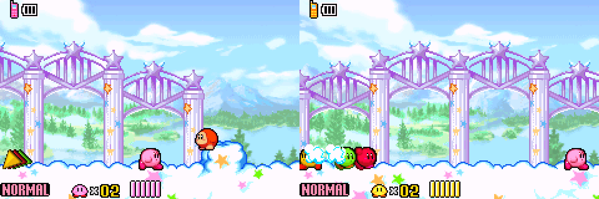

# Kirby Couch Co-op

**Two controllers. Two independent Kirby views. One RetroArch session.**

An experimental libretro core for playing **Kirby & the Amazing Mirror** with
two people on the same computer or Android device. Each player keeps the
original, complete GBA camera view and can move independently.



**[Download builds](https://github.com/Cristian2737/kirby-couch-coop/releases)** ·
**[Setup guide](docs/SETUP.md)** · **[How it works](docs/HOW-IT-WORKS.md)** ·
**[Build from source](docs/BUILDING.md)**

## What you get

- Two linked GBA instances inside one custom core, with one controller per player.
- Both complete views side by side or stacked, switchable while playing.
- Fullscreen focus on either player while both games keep running.
- Audio from either player, without duplicate background music.
- Cartridge saves and save states for both players together.

The game supplies the multiplayer adventure through its original link-cable
mode. This project supplies the two emulated systems, virtual cable, separate
inputs, and combined display. The other two Kirbys use the game's original AI.

This is a **custom emulator core**, not a ROM patch or a standalone game.
Use your own game copy. No Kirby ROM, BIOS, or game save is distributed.
The camera retains the original field of view; zooming out is not implemented.

## Prerequisites for playing

| Requirement | Details |
| --- | --- |
| Frontend | RetroArch with support for manually installed cores |
| Game | Your own USA Kirby & the Amazing Mirror `.gba` file |
| Controllers | Two independently detected controllers assigned to ports 1 and 2 |
| Core build | Windows x64, Android ARM64, or Android ARMv7, matching the frontend's architecture |
| GBA BIOS | Optional `gba_bios.bin` in RetroArch's System/BIOS directory |

**You do not need a compiler, Python, an Android SDK, or an NDK to use the
downloaded builds.** Those are development tools for building or testing source.

The tested USA ROM has SHA-1:

```text
274b102b6d940f46861a92b4e65f89a51815c12c
```

## Quick start

1. Download and extract the release. Install the matching `.dll` or `.so` core
   and its accompanying `.info` file using the [platform instructions](docs/SETUP.md).
2. Load **Kirby Couch Co-op (experimental)**, then open your original game ROM.
3. Assign different controllers to RetroArch ports **1** and **2**.
4. On **both** game screens, choose a file, then **Start Game → Multiplayer**.
5. When both players appear, player 1 confirms with **A**, chooses the Game Pak
   whose adventure progress to use, and confirms again.

In **Quick Menu → Core Options**, select **Side by side** or **Stacked**.
Use **Settings → Video → Scaling → Aspect Ratio → Core provided** to preserve
both complete views. Side by side gives larger views on a typical 16:9 TV.

## Compatibility and status

| Environment | Status |
| --- | --- |
| Windows x64, RetroArch 1.19.1 | Gameplay tested; initial user confirmed co-op works |
| Android ARM64 | Compiled; API exports and ELF alignment checked; device testing pending |
| Android ARMv7 | Compiled; API exports and ELF alignment checked; device testing pending |
| ONN Android streaming stick | Intended test device; performance and architecture not yet confirmed |
| Other libretro frontends | May work if they support this core's API requirements; untested |
| Standalone mGBA, VBA, or other standalone GBA emulators | Cannot load this libretro core directly |
| Original GBA hardware or a flash cartridge | Cannot use this emulator core |

On Android, match the **RetroArch app's** 32-bit or 64-bit architecture, not just
the processor. An ARM64 processor may be running a 32-bit system or app.
See the [Android/ONN instructions](docs/SETUP.md#android-and-android-tv-including-onn).

This is an early **0.1 experimental** release. Only the USA Amazing Mirror ROM
above has been tested. Faster devices may handle two emulated systems better;
Android speed is not guaranteed. Disable run-ahead, preemptive frames, rewind,
and RetroAchievements for this core. Cheats and network multiplayer are not
supported by this project.

## Saves

The core stores both cartridge saves in one custom **256 KiB `.srm`**. Its
save-state container captures both systems and the in-flight cable state.
Keep these files separate from normal single-player emulator saves. Give the
ROM a distinct local name, such as `Kirby Amazing Mirror - Couch Co-op.gba`,
or use a separate RetroArch save directory for this core.

## Source, dependencies, and credit

The complete source is included in this repository. `mgba/` vendors
[mGBA](https://github.com/mgba-emu/mgba) at commit
`fd9dc5c2cbf234365068855851107e762fc6211b`, with a three-line link-state fix.
`src/coop.c` implements this project's libretro frontend.

mGBA and this frontend use **MPL-2.0**. Third-party code retains its own notices;
see [LICENSE](LICENSE), [THIRD_PARTY_NOTICES.md](THIRD_PARTY_NOTICES.md), and the
vendored source. The build disables the upstream Qt/SDL frontends and optional
media, scripting, and graphics dependencies. See the
[dependency table and build commands](docs/BUILDING.md).

Thanks to **endrift / Jeffrey Pfau and the mGBA contributors** for the emulator
and link-cable implementation, and the **libretro / RetroArch contributors**
for the frontend API and tools. This project is unaffiliated with Nintendo,
HAL Laboratory, and the mGBA and RetroArch projects.

Bug reports should include your device, OS, RetroArch version/architecture,
core build, and reproduction steps. Please do not attach ROMs or BIOS files.
