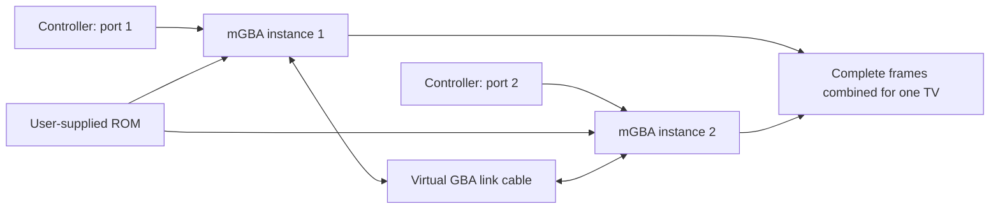

# How the co-op core works

## Two systems and a virtual link cable

Amazing Mirror already implements co-op through the GBA link port. The core
loads the supplied ROM into **two separate mGBA instances**. Each has its own
CPU, RAM, video, sound, cartridge-save slot, and controller input. mGBA's GBA
SIO lockstep coordinator supplies the virtual cable between them.

The game exchanges its ordinary multiplayer messages over that cable. No
ROM instructions are patched, and the two systems are not merely showing
independent copies of a single-player session. Players must select the
game's Multiplayer mode to join the same adventure.

## Scheduling

`src/coop.c` implements the libretro callbacks. For each `retro_run()` call it:

1. Polls the frontend and applies port 1 and port 2 inputs to separate systems.
2. Advances each awake system through mGBA's `runLoop()`.
3. Yields a system when the link coordinator's sleep callback says it is
   waiting for its peer. The peer's progress wakes it through the wake callback.
4. Continues until both systems have produced their next frame. A system that
   has finished its frame can still run if it must wake the other system.
5. Presents one combined video frame and drains both audio buffers, forwarding
   the selected player's sound.

This scheduler runs cooperatively on one frontend thread. It does not need
a second RetroArch process, OS-level window arrangement, a network server,
or frontend network play. A bounded loop detects stalls and reports a message
instead of letting the frontend spin indefinitely.

## Independent views

Each system renders its player's original **240×160** camera. The core copies
completed frames in `videoFrameEnded`, avoiding half-rendered views. It combines
the snapshots into a 480×160 side-by-side image or a 240×320 stacked image.
Fullscreen focus presents one 240×160 snapshot while both systems keep running.

The frontend scales this image to the display. This increases on-screen size
without changing the camera's field of view. Zoomed-out rendering and separate
physical display outputs are outside this release.

For a proportional display wider than 3:2, side by side gives each view a
larger scale than stacking. For a 16:9 TV, the side-by-side scale relative to
stacking is `2 × 16/9 ÷ 3`, approximately **1.185** per dimension. This is why
side by side is the default for widescreen TVs.

## Sound

Both emulated systems generate sound. The core drains both buffers and sends
only the selected player's samples to the frontend. The GBA's sample rate can
change through SOUNDBIAS; the core reports a changed output rate through
`RETRO_ENVIRONMENT_SET_SYSTEM_AV_INFO`. The frontend handles host audio output.

## Saves

### Cartridge-save RAM

The frontend sees one 256 KiB save buffer: two 128 KiB slots, one per GBA.
mGBA manages the game's actual cartridge-save type inside each slot. The
fixed combined format gives the frontend one persistent `.srm` file.

### Paired save states

The core uses a custom `KCOOP001` container. A 32-byte header records the two
serialized lengths and sleep flags, followed by two fixed 1 MiB state slots.
The total uncompressed container is **2,097,184 bytes**. Each named mGBA state
contains machine state, save data, RTC data, and mGBA's extra subsystem state,
including queued link events. RetroArch may wrap or compress this container.

Capturing both machines together is necessary: restoring just one endpoint
could leave the virtual cable referring to a different transfer or cycle.
This format is not a regular single-player mGBA state. Cross-build and
cross-platform state compatibility has not been established.

## The upstream queue fix

The vendored mGBA source differs from the pinned upstream commit only in
`mgba/src/gba/sio/lockstep.c`:

- The last free-list buffer node gets an explicit null `next` pointer during
  state restoration.
- The restored event queue's final `next` pointer is terminated after the
  stored events have been reconstructed.

Without those terminations, the queue can continue into nodes intended for
the free list. Initial testing found a connection regression after restoring
states. The patch is recorded in [UPSTREAM.md](../UPSTREAM.md); paired state
replay was retested during two-player gameplay.

## Build boundaries

The root CMake project reuses mGBA's libretro build target, removes its ordinary
single-system libretro frontend, adds this frontend and GBA lockstep driver,
and gives the resulting library its own filename. Windows directory-enumeration
code incompatible with the selected minimal-core configuration is excluded.
The upstream source is kept alongside the frontend so the public source tree
contains the corresponding emulator code and its notices.

The reference for the frontend interface is the
[libretro core development documentation](https://docs.libretro.com/development/cores/developing-cores/).
